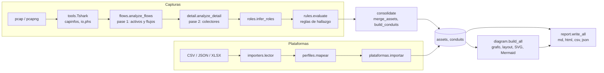

# Arquitectura

Cómo está construido el sistema, qué garantías mantiene y cómo falla. Complementa al README (uso y
"Cómo extender") y a [DECISIONES.md](DECISIONES.md) (el porqué). Las listas de reglas, opciones y columnas
no se repiten aquí: están en [CATALOGO.md](CATALOGO.md), generado del código.

## 1. Visión general

Dos entradas independientes producen la **misma estructura intermedia** (`assets` y `conduits`), y de ella
salen los reportes y diagramas. Esa estructura es el contrato que permite añadir una fuente nueva o un
formato de salida nuevo sin tocar el resto.

## 2. Componentes

| Paquete / módulo | Responsabilidad | No hace |
|---|---|---|
| `ot_assess/cli.py` | Orquesta el análisis de capturas; define las opciones | No contiene lógica de análisis |
| `ot_assess/cli_diagrama.py` | Subcomando `diagrama`: importación → diagramas | No analiza capturas |
| `ot_assess/tools.py` | Único punto que ejecuta procesos externos (`tshark`, `capinfos`, `editcap`) | No interpreta paquetes |
| `ot_assess/fields.py` | Campos y filtros de `tshark` | Se validan contra el `tshark` instalado antes de usarse |
| `ot_assess/flows.py` | Pase 1: activos, flujos, VLAN, volumen | No identifica equipos ni busca comandos |
| `ot_assess/detail/` | Pase 2: un colector por tema (identidad, texto claro, control, capa 2) | No emite hallazgos |
| `ot_assess/roles.py` | Rol y nivel Purdue por heurística | No es declarativo: infiere |
| `ot_assess/rules/` | Hallazgos: una función por detección, agrupadas por categoría | No lee archivos ni tshark |
| `ot_assess/standards.py` | Marcos de referencia por hallazgo; marcos propios por JSON | No evalúa cumplimiento |
| `ot_assess/consolidate.py` | Une capturas por MAC; construye conductos y su criticidad | |
| `ot_assess/importers/` | Lector de tablas, alias de columnas, conversión a `assets`/`conduits` | No distingue lectura de escritura (D5) |
| `ot_assess/diagram/` | Grafo, disposición, SVG y Mermaid | No conoce la fuente de los datos |
| `ot_assess/report/` | Un escritor por formato | No calcula: solo presenta |
| `ot_assess/catalog.py`, `texts.py` | Tablas de conocimiento y textos fijos | |
| `ot_assess/model.py`, `util.py` | `Capture`, `Assessment`; funciones puras | |
| `ot_assess/registry.py` | Lista que se llena con un decorador | |

Dependencias: no hay ciclos entre paquetes. `util` y `catalog` están en la base; `report` y `cli`, en la cima.
`flows`, `detail`, `rules` y `diagram` no se conocen entre sí. `importers` solo usa `util` y
`consolidate.criticidad_conducto`, para que una exportación y una captura calculen la criticidad con la misma regla.

## 3. Flujo de una captura

1. `cli.main` expande los archivos de entrada y localiza `tshark`, `capinfos` y `editcap` (`tools.find_tool`).
2. Se crea un paquete de un solo paquete (`editcap`) para **validar** campos y filtros contra el `tshark`
   instalado; los que no existan se descartan (`Tshark.valid_fields`, `valid_filter`).
3. Por captura: `capinfos` (metadatos) → `io,phs` (jerarquía de protocolos) → **pase 1** (campos de capas 2 a 4,
   hasta `--max-packets`) → **pase 2** (campos de aplicación, sobre un filtro que solo deja pasar los paquetes
   relevantes) → roles → reglas.
4. Se consolidan todas las capturas por MAC y se construyen los conductos.
5. `report.write_all` escribe cada formato; los diagramas se construyen una vez y se reutilizan.

Los dos pases leen la salida de `tshark` **en flujo** (`Tshark.fields_pass`, un generador): el consumo de
memoria depende del número de equipos y flujos únicos, no del tamaño del archivo.

## 4. Contratos de datos

Son diccionarios, no clases, por simplicidad. Estas son las claves de las que dependen otros módulos.

**`Capture`** (`ot_assess/model.py`): `path`, `name`, `info` (salida de `capinfos`), `protos`, `hosts` (por MAC),
`flows` (por `(origen, destino, puerto, transporte)`), `l2_flows`, `vlans`, `ethertypes`, `identity`, `cleartext`,
`control_ops`, `arp_events`, `dns_names`, `stp_tc`, `icmp_unreach`, `findings`, `flow_packets`, `sampled`.

**Activo** (`assets[id]`, lo producen `consolidate.merge_assets` e `importers`): obligatorias `mac` (identificador
único), `ips` (conjunto), `pkts`. Opcionales: `alias` (otros identificadores por los que un conducto puede
nombrarlo), `nombre`, `vendor`, `modelo`, `firmware`, `tipo`, `tipo_texto`, `role`, `purdue` (banda de nivel),
`zona` (zona de la plataforma).

**Conducto** (`conduits[i]`): obligatorias `src`, `dst`, `servicio`, `criticidad` (`Critica`, `Alta`, `Media`,
`Baja`), `pkts`, `bytes`, `escrituras`, `multicast`. El análisis de capturas añade nombres, roles, zonas y
sentido; el diagrama no los necesita.

**Hallazgo**: las claves están en `docs/CATALOGO.md` (sección "Archivos de salida"). `referencias` es un
diccionario `{clave de marco: texto}` que se fija al crear el hallazgo con **todos** los marcos registrados en
ese momento; por eso los marcos propios se cargan antes de analizar.

**`Assessment`**: `caps`, `assets`, `conduits`, `args`, `diagrams`, `estandares`. Es lo único que reciben los
escritores de reporte.

**Grafo** (`ot_assess/diagram/graph.py`): `Nodo` (`id`, `etiqueta`, `banda`, `tipo`, `escrituras_recibidas`...),
`Arista` (`a`, `b`, `fwd`, `back`, `crit`, `servicios`, `bytes`, `escrituras`...) y `Grafo`. Una *banda* es un
nivel Purdue o, con `--agrupar zona`, una zona de la plataforma.

## 5. Puntos de extensión

Cada uno es una lista que se llena con una función (patrón `registry.Registry`) o una tabla. El procedimiento
paso a paso está en la tabla "Cómo extender" del README. Lo importante para la auditoría:

- El **orden de registro** es el orden de ejecución y el orden de los hallazgos en los reportes. Está fijado por
  el orden de importación en `ot_assess/rules/__init__.py` y `ot_assess/detail/__init__.py`.
- Una regla nueva sin decisión de mapeo a marcos hace fallar `tests/test_standards.py`.
- Una regla, opción o columna nueva sin regenerar el catálogo hace fallar `tests/test_docs.py`.

## 6. Invariantes

| Invariante | Cómo se mantiene | Verificado por |
|---|---|---|
| Sin conexiones de red | No se importa ningún módulo de red | `06_revision_estatica.txt` |
| Un solo punto de ejecución externa, sin shell | Todo pasa por `ot_assess/tools.py`, con argumentos en lista | `06_revision_estatica.txt` |
| Salida determinista | Todo recorrido de conjuntos se ordena; los empates usan orden fijo (D10) | `test_salida_determinista` |
| Sin dependencias en ejecución, Python 3.9 o superior | Solo biblioteca estándar (D11) | `05_dependencias.txt` |
| Solo se escribe en la carpeta de salida | Los nombres de archivo son constantes; solo `--out` es variable | Revisión de `ot_assess/report/` |
| Texto de reportes en ASCII sin acentos | Convención (D12) | **No hay prueba**: es una convención |

## 7. Rendimiento y límites

- Por captura hay cuatro ejecuciones externas: `capinfos`, `tshark` con `io,phs`, pase 1 y pase 2. El tiempo es
  lineal con el tamaño y lo domina `tshark`.
- `--max-packets` (por defecto 1 000 000) acota el pase 1. El pase 2 **no** se acota: lee todos los paquetes que
  pasen el filtro. Con muestreo, los conteos de protocolo vienen del archivo completo y el inventario del
  muestreo; el reporte lo avisa.
- Crecen sin tope con la captura: equipos únicos, flujos únicos, `identity`, `control_ops`. Una captura muy
  grande con muchos equipos únicos puede agotar la memoria.
- Los diagramas están acotados por diseño (40 equipos y 60 trazos por defecto) y por eso son lineales en la
  práctica.

## 8. Modos de fallo

| Situación | Comportamiento actual | Hallazgo |
|---|---|---|
| Falta `tshark` | Termina con un mensaje que indica cómo instalarlo | Correcto |
| Captura corrupta, truncada o vacía | Se valida con `capinfos` antes de analizar y no se analiza: hallazgo "Captura ilegible o sin paquetes" y código de salida 2 (1 si ninguna es legible, sin reporte). Si `tshark` falla durante el análisis, la captura se descarta igual | Correcto (COR-01 cerrado) |
| `tshark` no soporta un campo | Se ignora; aviso solo en consola | COR-03 |
| Regla que depende de un dato que `capinfos` no entrega | Los duplicados se calculan con `editcap -d`; si `editcap` falla, la regla no se dispara | Correcto (COR-02 cerrado) |
| Archivo de entrada inexistente | Mensaje por `stderr`; sigue con los demás; sin entradas, código 1 | Correcto |
| Marco o mapeo JSON inválido | Termina con un mensaje que nombra el campo | Correcto (pruebas en `tests/test_standards.py` y `tests/test_importers.py`) |
| Exportación sin columnas de origen o destino | Termina y sugiere `--mapeo` | Correcto |
| Columna de plataforma irreconocible | Se avisa en el reporte ("Datos de origen y calidad") | Correcto |
| Extremo de un enlace sin activo en el inventario | Se dibuja como equipo no inventariado y se cuenta en los avisos | Correcto |

## 9. Decisiones que condicionan el diseño

D2 (mapeos orientativos), D4 (importación por alias), D5 (sin lectura/escritura en lo importado), D7 (registros por
decorador), D8 (diagramas sin dependencias y recortados), D10 (salidas deterministas). Detalle y motivos en
[DECISIONES.md](DECISIONES.md).
