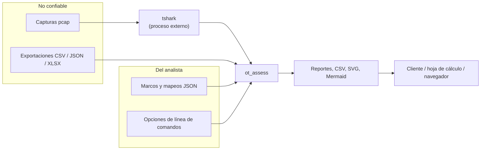

# Seguridad

Modelo de amenazas y controles de `ot_assess`, con la evidencia de cada afirmación. Los hallazgos abiertos
(`SEG-xx`) están en [AUDITORIA.md](AUDITORIA.md), apartado 4. Verificado el **2026-11-02**.

## 1. Qué hay que proteger

| Dato | Clasificación | Dónde vive |
|---|---|---|
| Capturas de red de una planta | **Confidencial del cliente**: topología, direccionamiento, firmware, comandos de control | Fuera del repositorio |
| Exportaciones de Nozomi, Claroty o Dragos | **Confidencial del cliente** | Fuera del repositorio |
| Reportes, CSV y diagramas generados | **Confidencial del cliente**: contienen el inventario y la topología | Carpeta de salida del operador |
| Código y documentación | Interno | Repositorio privado |
| Datos de prueba | Sintéticos, rotulados como tales (D9) | `tests/gen_pcaps.py`, `tests/gen_exports.py` |

Un reporte generado equivale a un mapa de la planta: quien lo tiene sabe qué equipos hay, cuáles escriben sobre
cuáles y con qué firmware.

## 2. Fronteras de confianza

- **No confiable**: todo lo que viene de la red capturada o de una plataforma. Los nombres de equipo, los
  hostnames, las cadenas de identidad y los valores de columna los puede controlar un tercero.
- **Del analista**: los JSON de marcos y mapeos y las opciones. Se validan igualmente, pero un error aquí es
  del operador, no de un atacante.
- La frontera que importa es la **de salida**: los datos no confiables terminan dentro de HTML, SVG, Mermaid,
  CSV y Markdown que otra persona abrirá.

## 3. Amenazas y controles

| ID | Amenaza | Control | Evidencia | Estado |
|---|---|---|---|---|
| A1 | Una captura maliciosa explota un disector de Wireshark | Ninguno en el código: es el binario externo. Mitigación operativa: equipo aislado, Wireshark al día | SEG-03 | Aceptado |
| A2 | Un nombre con HTML o script (hostname, nombre en la exportación) ejecuta código en el navegador al abrir el reporte | `html.escape` en todo texto externo de HTML y SVG; Mermaid sustituye `"`, `#`, `<`, `>` | `ot_assess/report/html.py`, `ot_assess/report/pagina.py`, `ot_assess/diagram/svg.py`, `ot_assess/diagram/mermaid.py`; prueba `test_nombres_hostiles_se_escapan` (incluye el título y el cliente) | Mitigado |
| A3 | Idéntico, pero en el Markdown | Solo se escapan `\|` y saltos de línea | `ot_assess/report/common.py`; SEG-06 | Abierto |
| A4 | Una celda `=...` se ejecuta como fórmula al abrir un CSV | Ninguno | SEG-02 (demostrado) | Abierto |
| A5 | Bomba de descompresión en un XLSX | Ninguno | SEG-01 | Abierto |
| A6 | Expansión de entidades XML en un XLSX | `xml.etree` con `expat` moderno rechaza la amplificación (verificado con `expat` 2.9.0: `ParseError`). Depende de la versión de `expat` del intérprete. El tope de descompresión de SEG-01 acota además el tamaño de cada parte que llega a `expat` | `ot_assess/importers/lector.py` | Mitigado por el entorno de ejecución |
| A7 | JSON profundamente anidado | Ninguno | SEG-08 | Abierto |
| A8 | Inyección de comandos mediante nombres de archivo | Los procesos se lanzan con una **lista** de argumentos y sin shell; las rutas viajan como elementos de la lista | `ot_assess/tools.py` (único uso de `subprocess`); `06_revision_estatica.txt` | Mitigado |
| A9 | Recorrido de rutas al escribir salidas | Los nombres de archivo de salida son constantes; solo `--out` es variable y es del operador | `ot_assess/report/`, `ot_assess/cli_diagrama.py` | Mitigado |
| A10 | Recorrido de rutas al leer un XLSX | Las partes del zip se leen por nombre; **nunca se extraen** al disco | `ot_assess/importers/lector.py` | Mitigado |
| A11 | Marco o mapeo JSON hostil | `json.loads` solamente; la clave del marco se restringe a `[a-z0-9_-]`; los campos del mapeo se validan contra los permitidos; los valores solo se usan como texto | `ot_assess/standards.py` (`cargar_archivo`), `ot_assess/importers/plataformas.py` (`cargar_mapeo`); pruebas `test_rechaza_archivos_invalidos`, `test_forzado` | Mitigado |
| A12 | Datos de cliente en el repositorio | `.gitignore` excluye capturas, comprimidos y reportes; las pruebas usan datos sintéticos; la revisión del historial se repite con cada paquete de evidencia | `.gitignore`; `06_revision_estatica.txt` | Mitigado (control humano + revisión) |
| A13 | Salidas legibles por otros usuarios del equipo | `os.umask(0o077)` durante `main` (`ot_assess/permisos.py`): carpeta nueva 0700, archivos 0600 en POSIX; una carpeta existente no se modifica; en Windows no tiene efecto | SEG-04 | Mitigado |
| A14 | Agotamiento de memoria con capturas enormes | `--max-packets` acota el pase 1; el resto no tiene tope | ARQUITECTURA.md, apartado 7 | Parcial |
| A15 | Binario `tshark` sustituido | No se verifica integridad; se imprime la ruta | SEG-05 | Aceptado |
| A16 | Cadena de suministro | Sin dependencias de terceros en ejecución. De desarrollo: `scapy`, `pyflakes`, `coverage`, sin versión fija | `05_dependencias.txt`; SEG-07 | Mitigado en ejecución |
| A17 | Conclusión falsa en un entregable por fallo silencioso | Captura ilegible validada con `capinfos` y código de salida de `tshark` (COR-01); lo demás, ninguno | COR-03 | Parcial |

La amenaza A17 no es un ataque, pero es la que más daño hace: un reporte que afirma "no se observaron
escrituras" sobre una captura que no se pudo leer.

## 4. Controles que se comprobaron y se sostienen

| Control | Cómo se comprobó |
|---|---|
| No hay conexiones de red | Búsqueda de importaciones `socket`, `urllib`, `requests`, `http.client`, `ftplib`, `smtplib`: ninguna |
| No hay `shell=True`, `os.system`, `eval`, `exec`, `pickle`, `marshal` ni `yaml.load` | Búsqueda estática: ninguno |
| Un solo módulo ejecuta procesos externos | `subprocess` aparece solo en `ot_assess/tools.py` |
| No hay secretos ni datos de cliente en el historial | Búsqueda de patrones de claves y de extensiones de captura y comprimidos en todos los commits |
| Los datos externos se escapan en HTML, SVG y Mermaid | Prueba con un nombre `<script>...` y `">` en el nombre, el título y el cliente |
| La salida es determinista | `test_salida_determinista` |
| `politica-fmc` (M3b, D48): `aplicar_fmc.py` no guarda ni imprime credenciales, verifica TLS, nunca borra ni modifica lo existente | La contraseña se pide con `getpass` (nunca por argumento) y se enmascara en consola y log; el log solo trae método, ruta y código; TLS verificado salvo `--inseguro` (con advertencia); el cliente solo admite GET y POST, crea una política nueva (se detiene si el nombre existe), no asigna ni despliega y por defecto simula. Pruebas: `tests/test_fmc.py`. La herramienta no se conecta a ningún FMC: el script lo ejecuta el analista |

Todas las búsquedas se pueden repetir con `scripts/evidencia.sh` (archivo `06_revision_estatica.txt`).

## 5. Recomendaciones para quien opera la herramienta

Mientras los hallazgos `SEG-xx` sigan abiertos, son requisitos del operador:

1. Analizar las capturas en un **equipo o máquina virtual dedicada**, con Wireshark actualizado (SEG-03).
2. Escribir la salida en un directorio con permisos restringidos y **borrarla** al cerrar el proyecto
   (SEG-04). Conservar los entregables solo en el canal acordado con el cliente.
3. **No abrir los CSV en una hoja de cálculo** sin revisar las celdas que empiecen con `=`, `+`, `-` o `@`
   (SEG-02).
4. No exportar ni anexar capturas ni reportes a issues, chats o tickets.
5. Confirmar que el repositorio es privado antes de subir cambios (ver PRO-02).
6. El **mapa del anonimizador** (`anonimizar --mapa`) revierte la seudonimización: es tan sensible como los
   datos originales. Se crea con permisos 0600, debe guardarse fuera del repositorio y de la carpeta de salida
   (el comando lo rechaza dentro del repo o de la salida) y no se comparte con la muestra anonimizada (D41).

## 6. Respuesta ante un incidente

- **Datos de cliente subidos al repositorio:** avisar al propietario, retirar el archivo **y reescribir el
  historial** (borrar el archivo en un commit nuevo no basta: sigue en el historial), invalidar las copias y
  avisar al cliente según el contrato. Revisar `evidencia/.../06_revision_estatica.txt` para confirmar el alcance.
- **Vulnerabilidad en el código:** agregar la fila al registro de AUDITORIA.md, corregir con su prueba y subir
  la versión.
